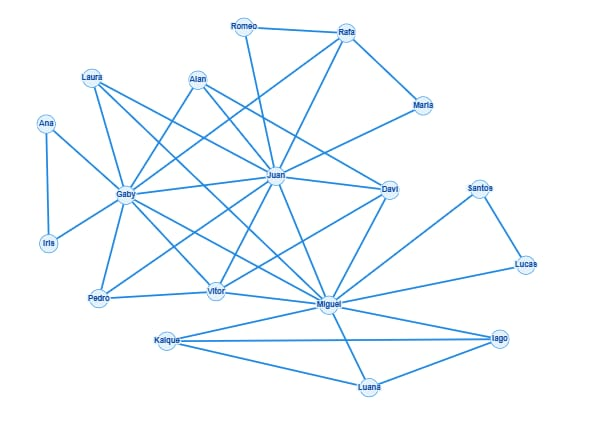

<div align="center">

# 🔗 ConectaUDF
### Uma rede de amizades representada por grafos

**Estruturas de Dados II | UDF | 2026**


</div>

## 👥 Integrantes

| Nome | Instituição |
|---|---|
| **Gabriella Rocha Gonçalves Cardoso** | UDF |
| **Miguel Henrico de Araújo França** | UDF |
| **Juan Carlos Siqueira de Lima** | UDF |

---

## 📌 Sobre o projeto

O **ConectaUDF** é um projeto acadêmico desenvolvido para a disciplina de Estruturas de Dados II, com o objetivo de aplicar conceitos fundamentais da **Teoria dos Grafos** na representação e análise de uma rede social.

A proposta consiste em construir uma rede de amizades, na qual cada pessoa representa um **vértice** e cada conexão de amizade representa uma **aresta**.

A partir dessa representação, foram realizadas análises sobre a estrutura da rede, a quantidade de conexões entre os participantes e a densidade do grafo.

O projeto utiliza um **grafo simples, não direcionado e não ponderado**, representado computacionalmente por uma lista de adjacência em Python.

## 📂 Estrutura do projeto

```text
ConectaUDF/
│
├── ConectaUDFColab.ipynb
│
├── RespostasQuestõesProfessoraConectaUDF.pdf
│
├── DesafioConectaUDF.pdf
│
├── grafo-conectaudf.png
│
└── README.md
```

### Descrição dos arquivos

| Arquivo | Descrição |
|---|---|
| **ConectaUDFColab.ipynb** | Notebook desenvolvido em Python, contendo a lista de adjacência e os algoritmos utilizados para calcular o grau dos vértices, a quantidade total de amizades e a densidade da rede. |
| **RespostasQuestõesProfessoraConectaUDF.pdf** | Documento contendo as APENAS as respostas às questões gerais propostas pela professora, separadas do desafio principal. |
| **DesafioConectaUDF.pdf** | Relatório do desafio, contendo a construção do grafo, a lista de adjacência, os cálculos, a interpretação dos resultados e as respostas às perguntas específicas. |
| **grafo-conectaudf.png** | Representação visual das conexões estabelecidas entre os participantes da rede. |
| **README.md** | Documentação geral do projeto, incluindo objetivos, metodologia, arquivos, resultados e ferramentas utilizadas. |

> **Observação:** o arquivo `DesafioConectaUDF.pdf` é o arquivo ao qual a professora deve acessar para avaliar a atividade.

## 🕸️ Representação do grafo

A rede foi construída a partir de três participantes principais: **Gaby, Miguel e Juan**.

Cada integrante contribuiu com contatos de seu círculo social, estabelecendo conexões entre pessoas que possuem relações de amizade ou conhecimento.

A representação visual permite observar como os diferentes participantes estão conectados e identificar aqueles que apresentam maior número de conexões.



## 🛠️ Metodologia de desenvolvimento

O desenvolvimento do ConectaUDF foi organizado em **três frentes de trabalho**, permitindo distribuir as atividades e integrar os resultados em uma única entrega.

### 1. Construção e modelagem do grafo

Inicialmente, foram selecionados os três integrantes do grupo como pontos de partida da rede.

A partir deles, foram adicionados outros participantes e estabelecidas as conexões de amizade.

Utilizamos a ferramenta **Graph Online** para construir a representação visual do grafo e identificar as relações entre os vértices.

Posteriormente, organizamos as conexões utilizando uma **lista de adjacência**.

### 2. Implementação em Python

A segunda etapa consistiu na implementação computacional da rede.

Utilizamos um dicionário Python para armazenar os participantes e suas conexões.

Com essa estrutura, desenvolvemos cálculos para determinar:

- A quantidade de vértices.
- O grau de cada vértice.
- A soma dos graus.
- O número total de arestas.
- A densidade da rede.

O código foi inicialmente desenvolvido e executado no **Visual Studio Code** e posteriormente disponibilizado no **Google Colab**.

### 3. Análise dos resultados e documentação

Na última etapa, realizamos a interpretação dos dados obtidos e respondemos às questões propostas pela professora.

Foram abordados temas como a identificação dos usuários mais conectados, recomendações de amizade com base em conexões em comum e cuidados relacionados à privacidade.

A documentação foi organizada no **Google Docs**, separando as respostas gerais da atividade do relatório específico do desafio.

## 📊 Resultados obtidos

A análise da rede apresentou os seguintes resultados:

| Métrica | Resultado |
|---|---|
| **Quantidade de vértices** | 18 |
| **Quantidade de arestas** | 36 |
| **Soma dos graus** | 72 |
| **Máximo de arestas possíveis** | 153 |
| **Densidade da rede** | 23,53% |
| **Vértices com maior grau** | Juan e Miguel |
| **Maior grau identificado** | 10 |

### Cálculo da densidade

A densidade representa a proporção de conexões existentes em relação ao número máximo de conexões possíveis.

Para grafos simples e não direcionados:

$$
D = \frac{2m}{n(n-1)}
$$

Onde:

- **D:** densidade do grafo.
- **m:** quantidade de arestas.
- **n:** quantidade de vértices.

Substituindo os valores encontrados:

$$
D = \frac{2 \times 36}{18 \times 17}
$$

$$
D = \frac{72}{306} \approx 0,2353
$$

**Densidade final: 23,53%.**

## 💻 Implementação computacional

A estrutura de dados utilizada foi um dicionário Python, no qual cada chave representa um vértice e sua respectiva lista contém os vértices adjacentes.

Exemplo:

```python
rede = {
    "Iris": ["Gaby", "Ana"],
    "Ana": ["Gaby", "Iris"],
    "Laura": ["Gaby", "Miguel", "Juan"]
}
```

A partir dessa representação, utilizamos operações de iteração e funções nativas da linguagem para calcular as métricas.

Exemplo do cálculo da densidade:

```python
tamanho = len(rede)

soma_graus = sum(len(amigos) for amigos in rede.values())

arestas = soma_graus // 2

densidade = (2 * arestas) / (tamanho * (tamanho - 1))

print("Total de usuários:", tamanho)
print("Total de amizades:", arestas)
print(f"Densidade: {densidade:.2%}")
```

O código completo pode ser consultado no arquivo [ConectaUDFColab.ipynb](./ConectaUDFColab.ipynb).

## 🧰 Ferramentas utilizadas

| Ferramenta | Aplicação |
|---|---|
| **Python** | Representação da rede e implementação dos cálculos. |
| **Google Colab** | Execução e compartilhamento do código Python. |
| **Visual Studio Code** | Desenvolvimento e execução inicial do código. |
| **Graph Online** | Construção e visualização do grafo. |
| **Google Docs** | Organização das respostas e elaboração dos relatórios. |
| **GitHub** | Armazenamento e documentação do projeto. |

---

<div align="center">

**ConectaUDF — Estruturas de Dados II**

Universidade do Distrito Federal (UDF) · 2026

*Projeto desenvolvido para fins acadêmicos.*

</div>
